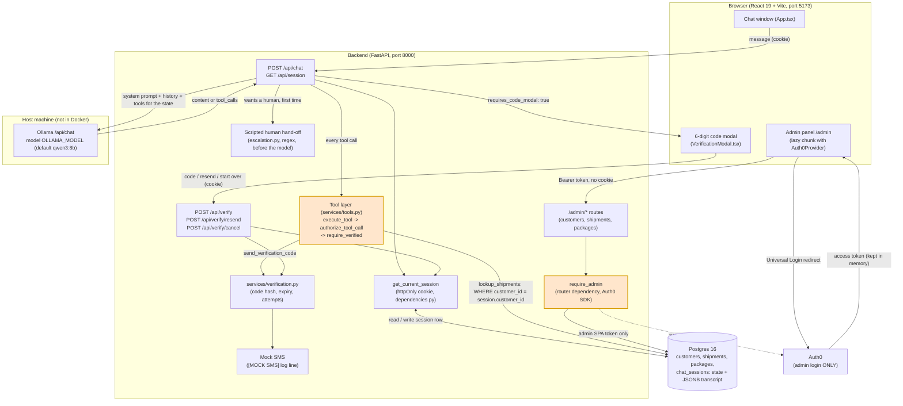

# 6.1 High-level system architecture

Regenerated against the implementation (Week 5).

What changed against the starting diagram: the chat is HTTP only (no WebSocket); there is no separate session store —
the session state and the transcript live in the same Postgres row (`chat_sessions`), keyed by an httpOnly cookie; the
code check is a backend service behind `POST /api/verify`, not a model tool; the human hand-off is a scripted step that
runs before the model; the admin gate is a router dependency (`require_admin`), not a middleware; Twilio is not used.

Where to look:

- Chat route: `backend/routers/chat.py:13`; session route: `backend/routers/session.py:13`; verify routes:
  `backend/routers/verify.py:22, 40, 58`.
- Session from the cookie only: `backend/dependencies.py:20-50`. Session columns and the JSONB transcript:
  `backend/models.py:97-141`.
- Enforcement point: `authorize_tool_call` and `require_verified`, `backend/services/tools.py:320-347`.
- Escalation before the model: `backend/services/chat.py:141-143`, `backend/services/escalation.py:24-58`.
- Mock SMS: `backend/services/mock_sms.py:6-13`, called from `backend/services/verification.py:41`.
- Ollama call: `backend/ollama_client.py:15-56` (`think: true`); model setting `backend/config.py:9`.
- Admin gate: `backend/routers/admin.py:30`, `backend/admin_auth.py:53-71`; admin client without the cookie:
  `frontend/src/api/adminMutator.ts:20-35`.
