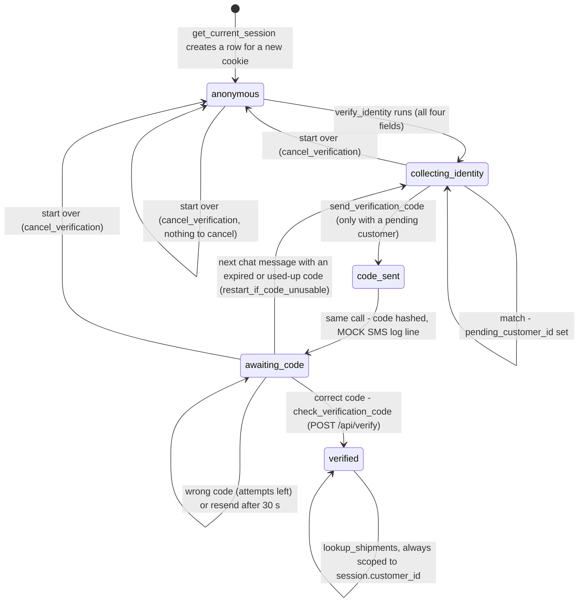

# 6.2 Conversation / identity-gating state machine

Regenerated against the implementation (Week 5). Spec reference: Section 6.2.

The states are exactly the `SessionState` enum (`backend/models.py:16-22`). Each transition is labelled with the code
that makes it. Differences from the starting diagram:

- There is no `IdentityRejected` and no `CodeExpired` state. A failed match keeps `collecting_identity` (with no pending
  customer) and the model answers neutrally; an expired or used-up code is handled at the start of the next chat turn.
- `code_sent` is passed through inside one call (`dispatch_verification_code`), so a request never ends in it.
- `escalated_to_human` is also passed through: the scripted hand-off enters it and returns to the previous state in the
  same request (see diagram 03).
- There is no "session ends / times out": a verified session stays verified for as long as its cookie lives (30 days).
  A new browser or a cleared cookie is a new anonymous session.

Rules behind the transitions:

| Rule | Value | Code |
|---|---|---|
| Code | 6 digits, only the SHA-256 hash is stored | `backend/services/verification.py:12-17, 31-32` |
| Expiry | 300 s (`VERIFICATION_CODE_TTL_SECONDS`) | `backend/config.py:15`; `verification.py:33-35` |
| Attempts | 5 (`VERIFICATION_MAX_ATTEMPTS`) | `backend/config.py:17`; `verification.py:65-80` |
| Resend | after 30 s (`VERIFICATION_RESEND_COOLDOWN_SECONDS`); new code, attempts back to 0; the number of resends is not limited | `backend/config.py:16`; `verification.py:148-161` |
| Restart | an expired or used-up code + a new chat message -> `collecting_identity`, the typed identity is forgotten | `verification.py:104-126`; `backend/services/chat.py:139` |
| Start over | `POST /api/verify/cancel` -> `anonymous`; refused (400) for a verified session | `verification.py:129-145`; `backend/routers/verify.py:58-70` |
| Only way to `verified` | `check_verification_code`, called only by `POST /api/verify`; never a model tool | `verification.py:52-89`; `backend/routers/verify.py:22-37` |
| Tools offered per state | identity tools in `anonymous` / `collecting_identity`; `lookup_shipments` only in `verified` | `backend/services/tools.py:257-317` |
| The code modal | shown when a response has `requires_code_modal` (state `awaiting_code`) | `backend/routers/chat.py:30`; `backend/routers/session.py:30` |
