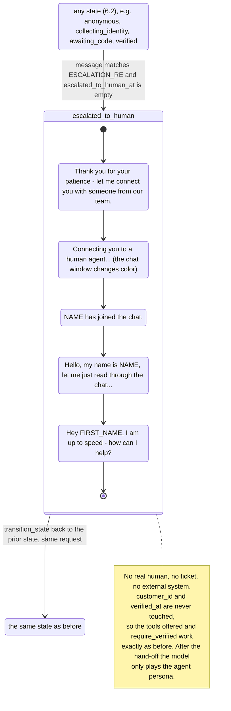

# 6.2b Human escalation sequence (Epic G — cosmetic, scripted)

Regenerated against the implementation (Week 5). Spec reference: Section 6.2b.

Differences from the starting diagram: the hand-off can start from **any** state (also while identity is being
collected or a code is pending), not only from Anonymous and Verified; it is triggered by a regex on the visitor's
message, before the model is called, and only once per session; the agent name is picked at random from five names;
the texts below are the real ones.

| Item | Implementation | Code |
|---|---|---|
| Trigger | regex `human`, `agent`, `representative`, `real person`, `speak to someone` (case-insensitive), checked before the model, only while `escalated_to_human_at` is empty | `backend/services/escalation.py:10-17`; `backend/services/chat.py:141-143` |
| Agent name | random: Alex, Jordan, Sam, Taylor, Morgan; stored in `escalated_agent_name` | `escalation.py:13, 42-43` |
| Steps and texts | five messages tagged `escalation_step` | `escalation.py:21, 37-53` |
| First name | the name the visitor typed (`pending_first_name`), else the verified customer's first name, else none | `escalation.py:47-52` |
| State | `escalated_to_human` only during the sequence, then the prior state; permanent trace: `escalated_to_human_at` | `escalation.py:34-35, 55-58` |
| Color change | the frontend reveals the messages 500 ms apart and switches the window color at `color_shift` | `frontend/src/App.tsx:8, 13, 94-105, 128` |
| After the hand-off | the system prompt adds the agent persona; tools are still chosen by state | `backend/services/chat.py:72-83`; `backend/services/tools.py:315-317` |
| Tests | gate is not bypassed; verified state is kept | `backend/tests/test_escalation.py:71, 95` |
