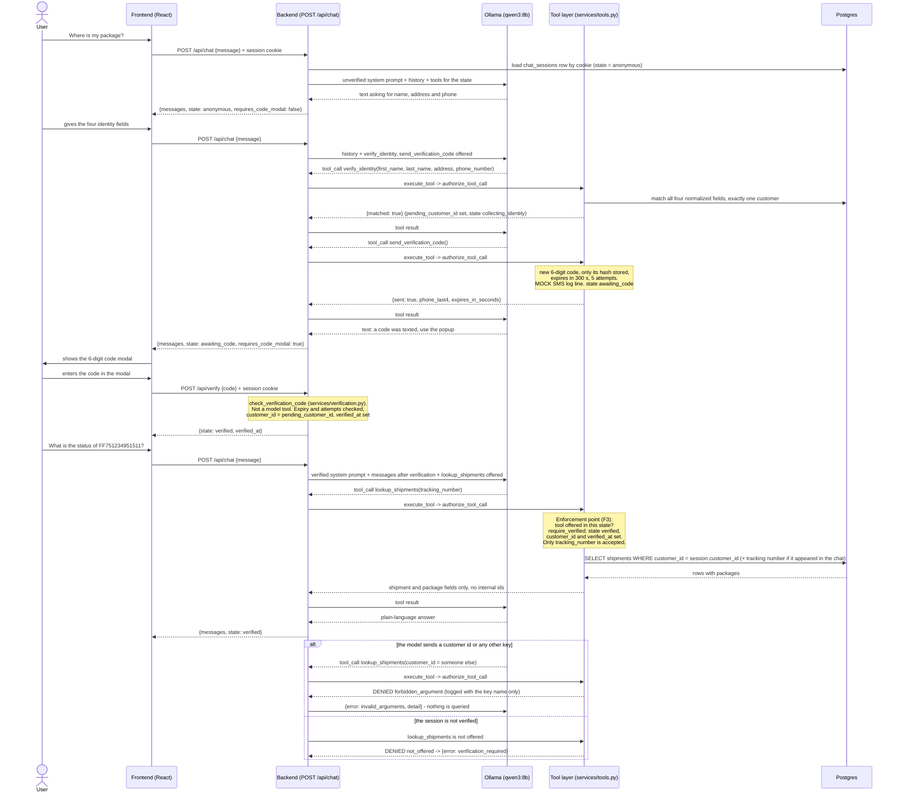

# 6.3 Tool-calling sequence over HTTP (the gating enforcement point)

Regenerated against the implementation (Week 5). This is the transport the project uses
(HTTP request/response, no WebSocket — see [05](05-tool-calling-sequence-websocket.md)).

Differences from the starting diagram: the routes are `/api/chat` and `/api/verify`; the session comes from an httpOnly
cookie, not a `session_id` field; there is no `request_identity_info` tool (the model asks in plain text); identity uses
two separate tools (`verify_identity`, then `send_verification_code`); the code check is a backend service, not a tool;
`lookup_shipments` has **no** customer argument at all.

Notes:

- The model gets up to `TOOL_CALL_MAX_ROUNDS` (4) rounds of tool calls per message, then a generic reply
  (`backend/services/chat.py:148-188`, `backend/config.py:19`).
- Every message about shipments runs a new `lookup_shipments`, so an admin change is visible on the visitor's **next**
  question; nothing is pushed to the browser (`backend/services/chat.py:53-54`).
- Log lines: `tool ALLOWED ...` / `tool DENIED ...` with names, states and argument shapes, never values
  (`backend/services/tools.py:397-426`).

Where to look: request/response models `backend/schemas.py:21-49`; route `backend/routers/chat.py:13-31`; tools and gate
`backend/services/tools.py:87-113, 133-136, 204-225, 315-347`; matching `backend/services/customer_match.py`; code check
`backend/services/verification.py:52-89`; verify route `backend/routers/verify.py:22-37`.
