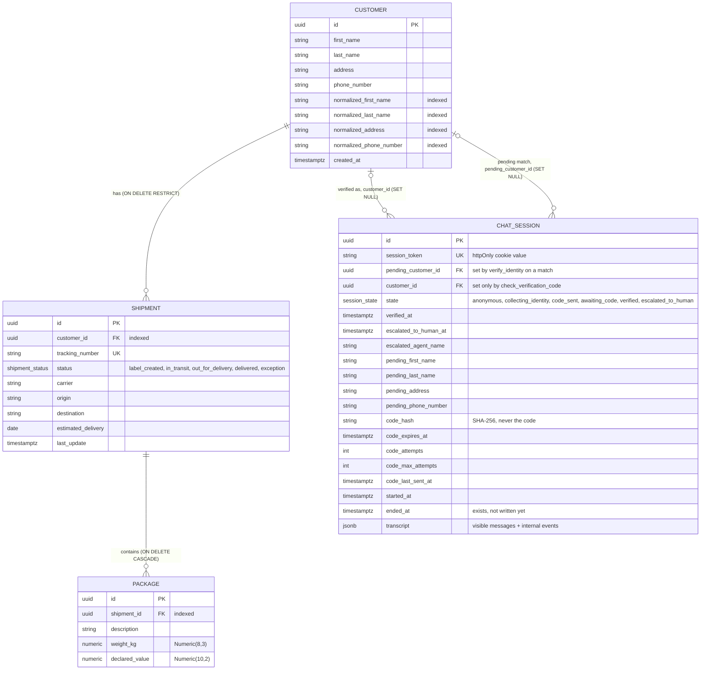

# 6.4 Data model (ERD)

Regenerated against the implementation (Week 5). Spec reference: Section 6.4. Source of truth: `backend/models.py` and
the Alembic migrations in `backend/alembic/versions/`.

Differences from the starting diagram: customers also store normalized copies of the four identity fields (indexed,
used for matching); `status` and `state` are Postgres enums; a chat session links to a customer in **two** ways (the
pending match, and the verified customer); the code and the typed identity live on the session row; there is no
`ADMIN_USER` table — admins exist only in Auth0.

Notes:

- Columns and keys: `backend/models.py:35-141` (enums `:16-32`, foreign keys `:63-66`, `:87-89`, `:105-113`).
- A customer with shipments cannot be deleted; the admin API answers 409 `customer_has_shipments`
  (`backend/services/admin.py:118-125`). Deleting a customer sets both session links to NULL; a verified session left
  without `customer_id` fails closed in `require_verified` (`backend/services/tools.py:320-327`).
- The transcript is one JSONB list per session. Entries with an `event` key (state changes, verification outcomes, the
  tool-call cap) are internal and are filtered out of every API response (`backend/services/transcript.py:14-26`).
- Admin identity: Auth0 only. The backend stores no admin rows; logs carry a short hash of the Auth0 user id
  (`backend/admin_auth.py:36-43`).
