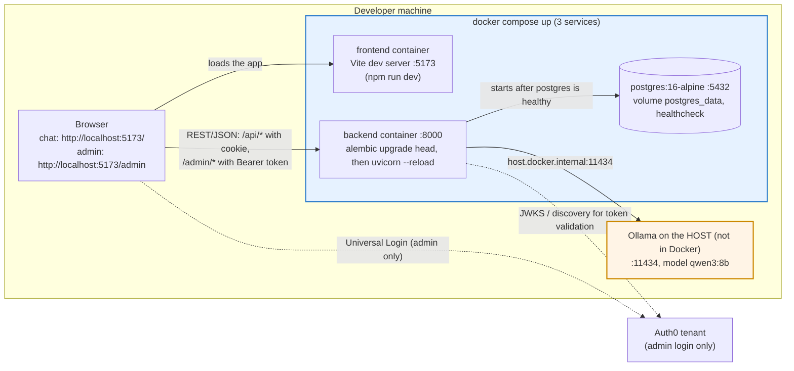

# 6.5 Deployment / local dev topology

Regenerated against the implementation (Week 5). Spec reference: Section 6.5 (baseline tier).

Differences from the starting diagram: the frontend is the Vite dev server on port 5173 (not 3000); the browser loads
the app from 5173 but calls the API on 8000 directly (CORS allows `FRONTEND_ORIGIN`); REST/JSON only; Auth0 is used by
the browser (login) and by the backend (keys for token validation); Twilio is not used.

Where to look: `docker-compose.yml:1-60` (ports `:5`, `:20`, `:46`; `OLLAMA_BASE_URL` `:25`; `extra_hosts` `:37-38`;
`service_healthy` `:39-41`); `backend/Dockerfile:12`; `frontend/Dockerfile:10-12`; API base URL
`frontend/src/api/mutator.ts:3-8`; CORS `backend/main.py:16-22`; Auth0 in the browser `frontend/src/admin/AdminRoot.tsx`;
Auth0 in the backend `backend/admin_auth.py:23-33`.
